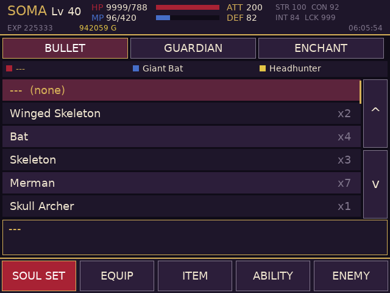
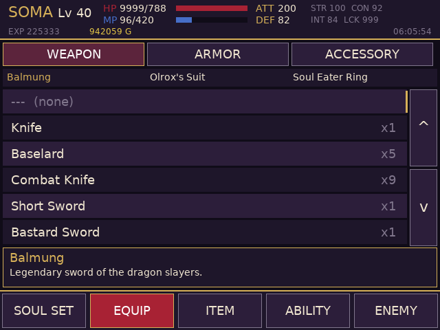
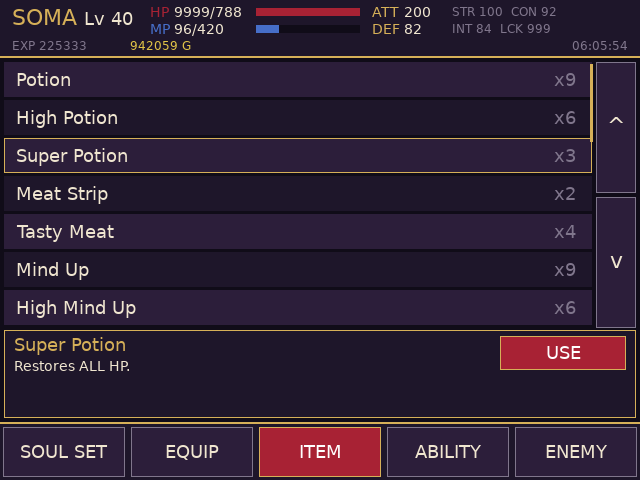
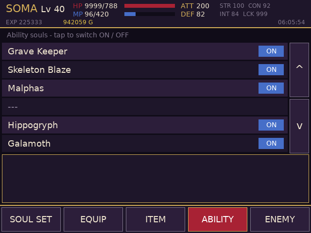
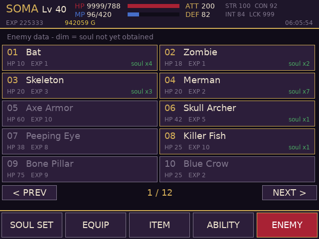
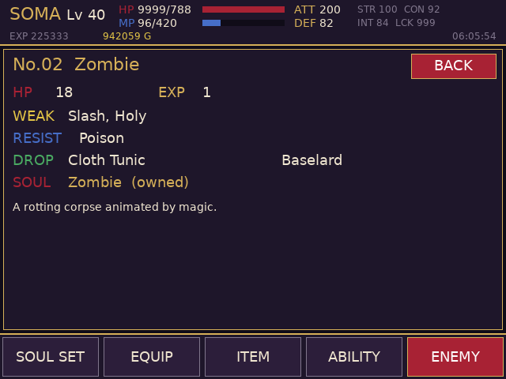
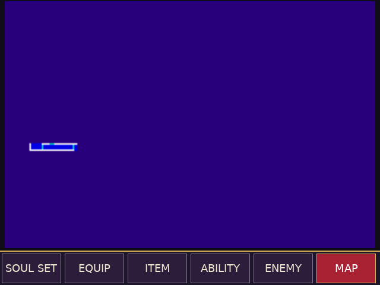

# Aria of Sorrow companion (RG DS)

Touch companion for *Castlevania: Aria of Sorrow (USA)* on the Anystream RG DS (ROCKNIX). The game runs in
RetroArch's mGBA core on the top panel; `aos-bottom` runs on the bottom panel (DSI-1) and shows six tabs:

<p>
 
 
 

</p>

| Tab | What it does |
| --- | --- |
| SOUL SET | Bullet / Guardian / Enchant: owned souls with counts, tap to equip (or clear) |
| EQUIP | Weapon / Armor / Accessory: owned gear, tap to equip; the game recalculates ATT/DEF itself |
| ITEM | Consumables with counts and descriptions; USE for Potion, High/Super Potion, Meat Strip, Tasty Meat, Mind Up, High Mind Up, Mana Prism |
| ABILITY | The six ability souls with ON/OFF switches |
| MAP | The castle map, drawn live from the game's explored-room flags (full screen, no header; unexplored rooms as a dim grey outline), so it follows your exploration without opening the game's map. SELECT on the handheld toggles this tab. The layout is learned from the game once, automatically (see Map tab notes) |
| ENEMY | All 113 enemies (HP, EXP, weakness, resistance, drops, soul, description); dim = soul not obtained |

Lists scroll by dragging or with the arrow buttons. The header shows level, HP/MP, ATT/DEF, stats, EXP, gold and play time.
Nothing from the ROM is shipped: names, descriptions and enemy data are read from the running game's ROM over RetroArch.

## How it works
It talks to RetroArch's network command interface (UDP 55355,
`READ_CORE_MEMORY` / `WRITE_CORE_MEMORY`), reads touch straight from the bottom panel's evdev node, and the GBA wrapper
(`gba-launch`) starts it with the game, opens the command port only for that session and closes it afterwards.

Memory map (EWRAM; the save slot at `0x0201324C` mirrors the SRAM slot byte for byte): see `src/aos_data.h`.
Highlights: items = 136 bytes of counts at `0x02013294`; souls = four nibble-packed count arrays (bullet 56, guardian 24,
enchant 35, ability 6); equipped soul bytes `0x02013269..6B` (index+1), weapon `0x02013268` (item-32), armor `0x0201326C`
and accessory `0x0201326D` (item-91); ability switches are a bit mask at `0x02013396`. Text is the ROM string table at
`0x08506B38`, enemies are 36-byte records at `0x080E964C`.

## Build / install
```sh
./build.sh                 # arm64 Debian trixie container (needs Docker/colima) -> build/aos-bottom
DEVICE=192.168.0.105 ./deploy.sh   # copies aos-bottom + the device's DejaVuSans.ttf to /storage/roms/ports/aos-companion/
```
Then copy `gba-launch` next to `aos-bottom` (`chmod +x`) and, in `/storage/.config/emulationstation/es_systems.cfg` (back it up
first), change the `gba` system's `<command>` from `/usr/bin/runemu.sh %ROM% ...` to
`/storage/roms/ports/aos-companion/gba-launch %ROM% -P%SYSTEM% --core=%CORE% --emulator=%EMULATOR% --controllers="%CONTROLLERSCONFIG%"`.
Other games still go through the stock launcher. Create an empty `/storage/roms/ports/aos-companion/no-companion` file to get plain mGBA.

## QA on the device
`qa/launch_like_es.sh` launches the game through the wrapper with EmulationStation's environment; `qa/touchd.py` is a virtual
multitouch screen (`qa/start_touchd.sh`, then `echo "tap:300,450" > /tmp/touch.fifo`) and `qa/start_app.sh` runs the app against it.
Set `AOS_TEST_TAPS="ms,x,y;..."` to inject taps through the real tap handler.

## Caveats
* USA ROM only (`A2CE`). Writes go to the running game's RAM; nothing is saved until the game itself saves.
* Weakness/resistance names (Slash, Fire, Ice, Thunder, Poison, Holy, Curse, Dark) were matched against the in-game icons for
  the common ones; the Thunder/Curse labels are unverified.
* Healing items are applied by the companion (HP/MP written directly), they do not run the game's item code.

## Map tab notes
* The layout (which flag draws which room) is learned from your own running game and stored locally; nothing from the ROM is shipped.
* It builds itself once, automatically, the first time the game is in normal play (about 20 seconds; the game's map flashes on the top screen), and is kept in `map-layout.cache`. `BUILD LIVE MAP` on the tab repeats it by hand.
* It needs RetroArch's `network_remote_enable` + `network_remote_enable_user_p1` (`gba-launch` turns them on for the session and off again afterwards). The test patterns written into the explored-room flags are always put back.
* The live map reads the explored-room flags (`0x020000C4`, `0x020001FC`) a few times a second. There is no position marker yet.
* Reads are batched in 8 KB chunks (`ra_client.c`) because RetroArch answers one network request per frame.
