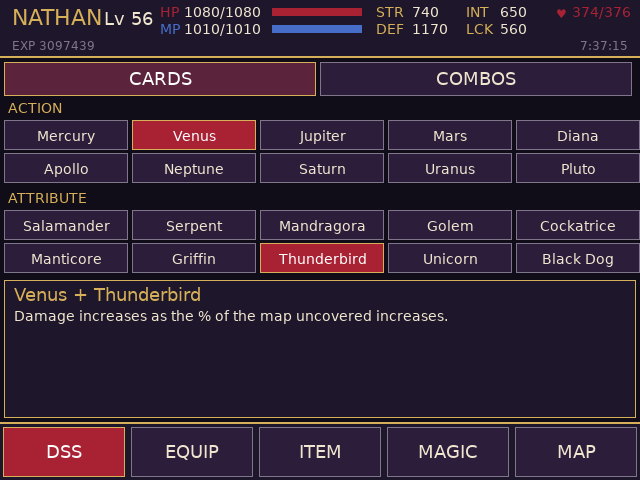
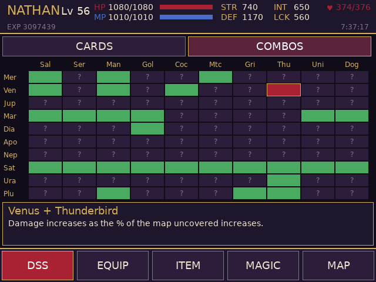
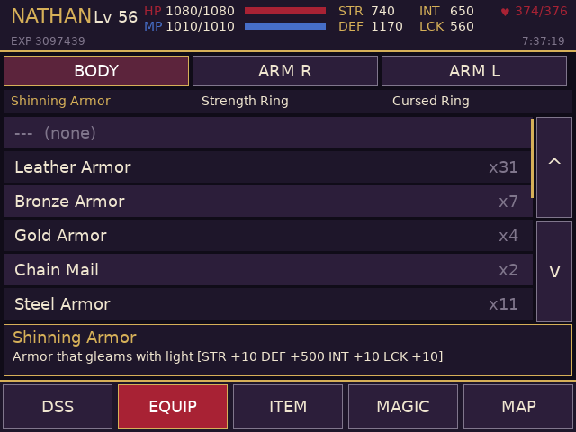
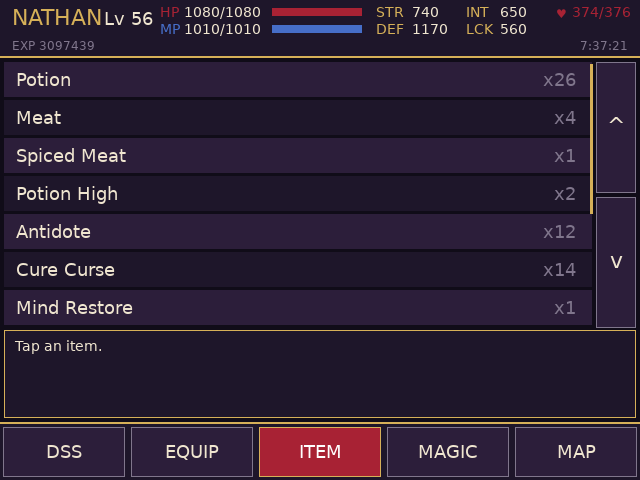
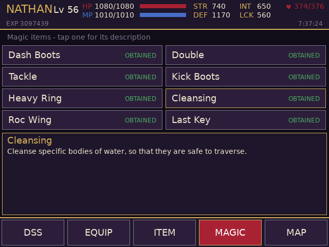
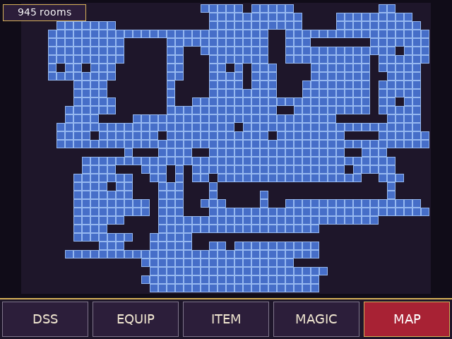

# Circle of the Moon companion (RG DS)

Touch companion for *Castlevania: Circle of the Moon (USA)* on the Anystream RG DS (ROCKNIX). The game runs in
RetroArch's mGBA core on the top panel; `cotm-bottom` runs on the bottom panel (DSI-1) and shows five tabs:

<p>
 
 
 
</p>

| Tab | What it does |
| --- | --- |
| DSS | CARDS: the ten Action and ten Attribute cards; tap an owned card to equip it (like the game's DSS menu, it takes effect at once). The box shows the effect of the equipped pair. COMBOS: the 10 x 10 table of combinations, green = found; tap one to equip that pair and read its effect |
| EQUIP | Body armor and the two arm slots (BODY / ARM R / ARM L); owned gear with stock counts, tap to equip or clear. The description box shows the item text and its STR / DEF / INT / LCK bonus. The game recalculates the stats itself, so they follow immediately |
| ITEM | Consumables with counts and descriptions |
| MAGIC | The eight magic items (Dash Boots, Double, Tackle, Kick Boots, Heavy Ring, Cleansing, Roc Wing, Last Key) with their descriptions |
| MAP | The castle map (48 x 34 rooms), drawn live from the explored-room flags (full screen, no header). SELECT on the handheld toggles this tab |

Lists scroll by dragging or with the arrow buttons. The header shows level, HP/MP, STR/DEF/INT/LCK, hearts, EXP and play time.
Nothing from the ROM is shipped: names, descriptions and equipment bonuses are read from the running game's ROM over RetroArch.

## How it works
It talks to RetroArch's network command interface (UDP 55355, `READ_CORE_MEMORY` / `WRITE_CORE_MEMORY`), reads touch straight
from the bottom panel's evdev node, and the GBA wrapper (`gba-launch`) starts it with the game, opens the command port only
for that session and closes it afterwards. The structure is the same as the Harmony of Dissonance and Aria of Sorrow companions.

Memory map: see `src/cotm_data.h`. The game works directly on its save slot, which sits in EWRAM at `0x02025358`
(`"DRACULA AGB"` header, byte for byte what goes to SRAM), so one 1 KB read gives everything. Highlights (offsets into the slot):
level `+0x30C`, EXP `+0x310`, HP / MP pairs `+0x2D6/+0x2DA` and `+0x2DE/+0x2E2`, hearts `+0x2E4`, stat totals `+0x2EE / +0x2F6 / +0x2FE / +0x306`
(three copies each), equipped DSS cards `+0x314` (attribute) and `+0x315` (action), both 1-based, equipment `+0x316..+0x318` (item ids),
card flags `+0x31C`, combination flags `+0x330` (action * 10 + attribute), stock counts per item id `+0x394`, magic items `+0x3D7`,
explored rooms `+0x100` (34 rows of 8 bytes, LSB = column 0), play time `+0x0A0` (frames).

ROM: text is one byte per character from a frequency-ordered table (see `InitCharTable` in `src/main.c`); item names at `0x08391A0F`,
item descriptions `0x08395583`, DSS combination effects `0x083940D5`, card lore `0x08395EDA`, magic item texts
`0x08393EAA`, equipment bonuses (4 x s16 per item id) at `0x080E0970`.

## Build / install
```sh
./build.sh                         # arm64 Debian trixie container (needs Docker/colima) -> build/cotm-bottom
DEVICE=192.168.0.105 ./deploy.sh   # copies cotm-bottom, gba-launch and the device's DejaVuSans.ttf to /storage/roms/ports/cotm-companion/
WRAPPER=1 DEVICE=192.168.0.105 ./deploy.sh   # also installs gba-launch as the wrapper EmulationStation calls
```
EmulationStation's `gba` system already calls `/storage/roms/ports/tmc-rgds/gba-launch`; `WRAPPER=1` replaces it with this folder's
`gba-launch` (the same wrapper plus a Circle of the Moon block; the previous one is kept as `gba-launch.bak-cotm`). Other games
still go through their own branches / the stock launcher. Create an empty `/storage/roms/ports/cotm-companion/no-companion` file to get plain mGBA.

## QA on the device
`qa/launch_like_es.sh` launches the game through the wrapper with EmulationStation's environment; `qa/touchd.py` is a virtual
multitouch screen (`qa/start_touchd.sh`, then `echo "tap:300,450" > /tmp/touch.fifo`) and `qa/start_app.sh` runs the app against it.
Set `COTM_TEST_TAPS="ms,x,y;..."` to inject taps through the real tap handler (the app starts on the DSS tab, so tap a tab first).
Careful: taps on cards or equipment rows change the running game.

## Caveats
* USA ROM only (`AAME`). Writes go to the running game's RAM; nothing is saved until the game itself saves.
* Not verified on a save that lacks cards: the card flags at `+0x31C` are assumed to be Action cards first, then Attribute cards (all 20 are owned in the test save).
* The HP / MP pairs are told apart by value (the smaller is the current one).
* The map shows explored rooms only (no walls, doors or player marker yet), and there is no enemy tab: the enemy stat table has not been located.
* Items can be browsed but not used from the companion.
