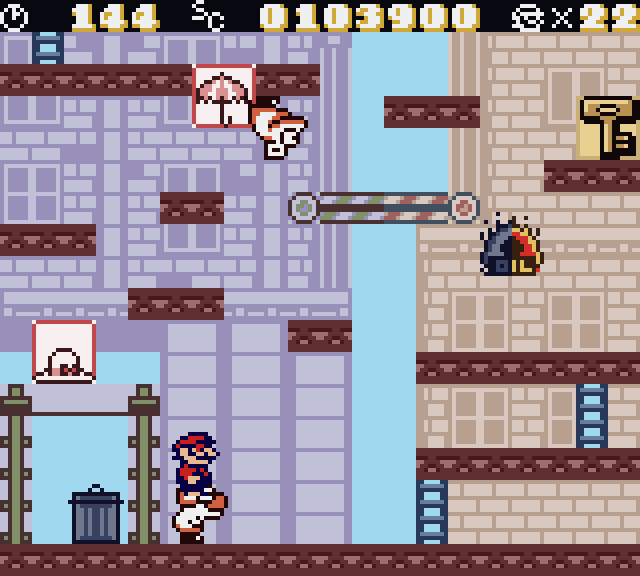

<p align="center">
  
</p>

# Donkey Kong (Game Boy, SGB Enhanced) — Game Boy Color colour patch

`dk-color.ips` turns the Super Game Boy–enhanced DMG ROM into a Game Boy Color (CGB-compatible) game with real colour
that works on emulators and handhelds **without Super Game Boy support** (for example the RG DS SameBoy core). On a
plain DMG or a real SGB the game's original code path still runs.

### Screens

|  |  |  |
|:--:|:--:|:--:|
| Big-City 1-2 | Big-City scrolling stage | Forest 2-1 |


* Apply to **your own** copy of the original ROM
  (SHA-1 `6ed661bd1d6d8cdd48e1c10f8ca4e8dcba49128e`, 512 KB, *Donkey Kong (Japan, USA) (En) (SGB Enhanced)*).
* `python3 apply_patch.py original.gb dk-color.ips dk-color.gb` (or any IPS patcher, e.g. Flips).
  The patched ROM has SHA-1 `66560499fe7c1acc35217686da215c151589e388`.
* Run it in a CGB-capable emulator (SameBoy, mGBA, BGB, Gambatte) or on a Game Boy Color.
* **No ROM is included in this repository.** Only the patch (my own code and colour data) and the build sources.

## What the patch does
* Header flag `$143 = $80` (CGB-compatible), header and global checksums fixed.
* The game already sends SGB colour packets. On a CGB the patch pretends an SGB is present, swallows the packets and
  replays them as CGB BG palettes, a 20x18 attribute map (uploaded to VRAM bank 1 with GDMA) and per-sprite OBJ palettes.
  Palettes are re-derived from the game's own BGP/OBP every frame, so fades keep working.
* The game redraws with a chain of scan-line interrupts; the interrupt vectors are wrapped (WRAM bank switch) and the
  VBlank is held back while a scan-line handler runs, which fixes a once-per-few-seconds blank-frame flicker.
* **Hand-made stage looks** (override on top of the SGB colours, selected by the level counter `$C85C`):
  * Big-City 1-2 — sky, lilac tower, tan building, brown-red girders, green blocks, gold key and lock, dark HUD.
  * The scrolling Big-City stage — same look, with a map indexed by background row so colours follow the scroll.
  * Forest 2-1 — the pink trunk shade is blue; Mario, turtles, spiky enemies and the boar each have their own palette.
* Donkey Kong is brown and beige in the classic stages 2, 3 and 4 (his tiles differ per stage).

## Known limits
* Only those stages have the hand-made look; every other stage uses the game's own SGB colours (washed-out pastel).
* Donkey Kong is still green in the very first classic stage: recolouring him there needs a sprite pass inside VBlank,
  which overruns VBlank on accurate emulators (SameBoy, the RG DS core) and garbles the tile uploads. The build is
  available as `DMA=1 ./make.sh` for experiments, but it is **not** what `dk-color.ips` contains.
* Colour is per 8x8 cell, like on the SGB.

## Build from source
```
pip install pyboy
./make.sh "Donkey Kong (Japan, USA) (En) (SGB Enhanced).gb"      # -> out/dk-color.gb, out/dk-color.ips
```
* `color/hooks.s` — the SM83 hooks and the stage overrides (assembled by `tools/gbasm.py`).
* `tools/dkdata.py` — turns the game's SGB packets (bank `$1E`) into compact colour commands.
* `tools/dkbuild.py` — patches the original ROM, writes the IPS and verifies it applies.
* `tools/sgbdump.py` — dumps the SGB palette/attribute data from your own ROM (kept local in `out/sgb/`).
* `data/ovr*.json` — palettes, attribute maps and sprite-class tables of the stage looks.

## Legal
Apply the patch only to a ROM you own. Do not share the ROM, the dumps in `out/`, or any extracted game assets.
