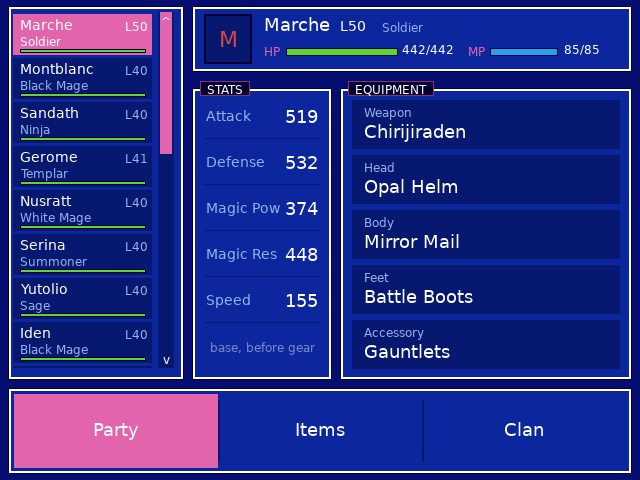
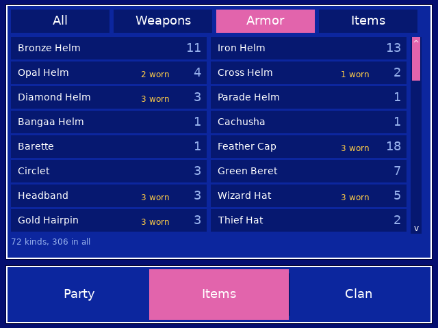
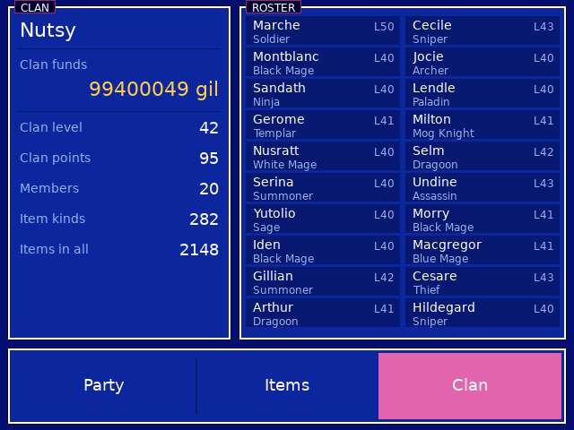

# Final Fantasy Tactics Advance companion (RG DS)

Touch companion for *Final Fantasy Tactics Advance (USA)* on the Anystream RG DS (ROCKNIX). The game runs in RetroArch's mGBA core on the top
panel; `ffta-bottom` runs on the bottom panel (DSI-1) with three tabs (Party, Items, Clan):

<p>
 

</p>

| Tab | What it does |
| --- | --- |
| PARTY | Left: the clan's units (scroll with a drag or the strip) with job, level and HP. Header: level, job and HP / MP bars (tap a bar to refill it). STATS: base Attack / Defense / Magic Pow / Magic Res / Speed. EQUIPMENT: weapon, head, body, feet and accessory by name |
| ITEMS | The shared inventory with owned and worn counts, filtered All / Weapons / Armor / Items |
| CLAN | Clan funds, clan level and points, member and item totals, and the whole roster (tap a member to open them on Party) |

Everything is read live from the running game. Item names are read from the cartridge's own text at run time, so nothing from the ROM is shipped.

## Notes
- The stats are the units' base values; the game's own status screen adds the equipment's bonuses on top.
- Job names are filled in for the jobs seen so far (`kJob` in `src/main.c`); any other job shows as `Job N`.
- Abilities, JP and the clan's missions and laws are not read yet.

## How it works
It talks to RetroArch's network command interface (UDP 55355, `READ_CORE_MEMORY` / `WRITE_CORE_MEMORY`), reads touch straight from the bottom
panel's evdev node, and the GBA wrapper (`gba-launch`) starts it with the game, opens the command port only for that session and closes it afterwards.
Memory map: see `src/ffta_data.h`. Highlights: the roster is 20 units of 0x108 bytes from EWRAM `0x02000080` (name pointer, level, HP / MP, base stats,
five equipment ids, job); clan funds at `0x02001F64`; the inventory is a list of `{item id, owned, worn}` entries from `0x02001940`. Item ids
index the ROM's name table at `0x08526680` (id + 0x7B).

## Build / install
```sh
./build.sh                         # arm64 Debian trixie container (needs Docker/colima) -> build/ffta-bottom
DEVICE=192.168.0.105 ./deploy.sh   # copies ffta-bottom, gba-launch and the device's DejaVuSans.ttf to /storage/roms/ports/ffta-companion/
```
Then add the Final Fantasy Tactics Advance branch of `gba-launch` to the wrapper you already use (or point the `gba` system's `<command>` at it).
Other games still go through the stock launcher.
