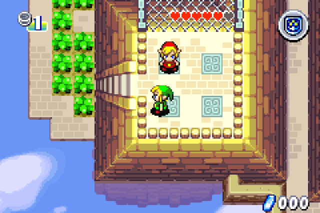
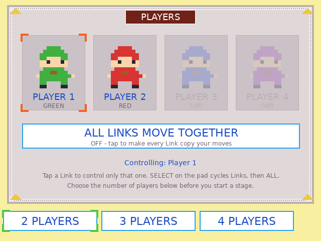
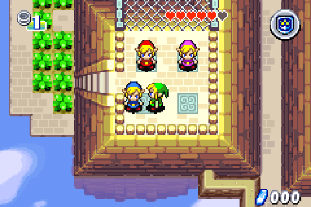
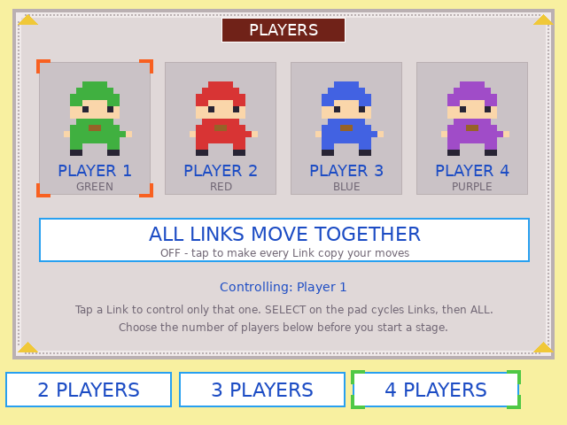
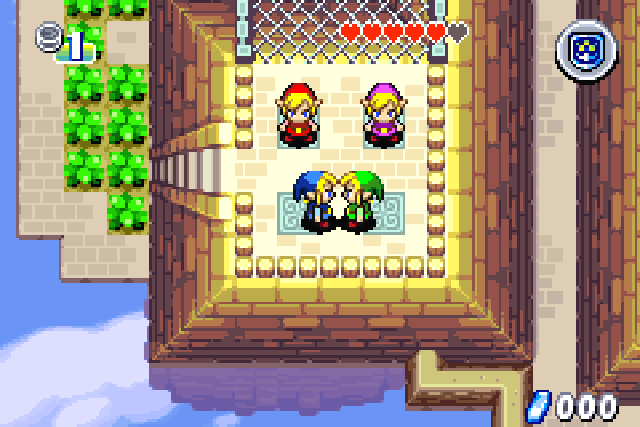
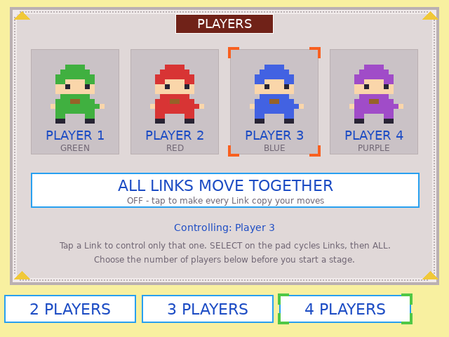
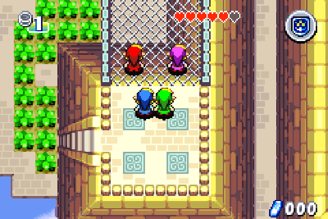
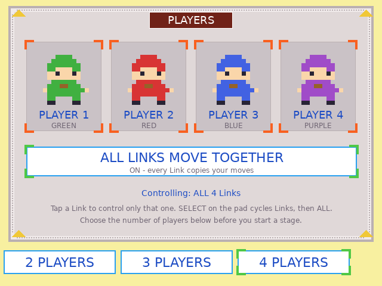

# Four Swords solo (RG DS)

Play *The Legend of Zelda: Four Swords* (GBA, via RetroArch mGBA) by yourself, with **2, 3 or 4 Links**, and choose
which Link your controls drive, or make **all Links move together**. Two parts:

* `fourswords_solo.ips`: a small patch for your own copy of the ROM (USA, `AZLE`). It fakes the link-cable partners so
  the game starts without "Linking with other systems...", and adds the controls below.
* `fs-bottom`: a touch companion for the RG DS bottom panel, styled like the Minish Cap companion.

Game frames below come from the patched ROM run in mGBA; the companion panels are from the RG DS.

| | Game (top panel) | Companion (bottom panel) |
|---|---|---|
| 2 Links, green (Player 1) |  |  |
| 4 Links, green (Player 1) |  |  |
| 4 Links, blue (Player 3), camera follows blue |  |  |
| 4 Links, all move together |  |  |

## Two handhelds over wifi
`netplay/` has a separate patch, `fourswords_netplay.ips`, plus a small wifi bridge (`fs-link.py`) and a launch wrapper, so
**two handhelds** can play Four Swords together as if on a link cable, each with its own copy of the game. It was tested
between an RG DS and an H700 device. See [netplay/README.md](netplay/README.md).

## Controls
* **Player count:** tap **2 / 3 / 4 PLAYERS** on the companion *before* you start a stage (before "Linking with other systems..."
  on the game's menu is fine; changing it inside a stage is not supported).
* **Which Link you drive:** tap a Link on the companion. The other Links stand still, and the camera follows the one you drive
  (including when it is off screen).
* **All Links move together:** tap **ALL LINKS MOVE TOGETHER** (every Link copies your moves).
* **On the pad:** **Select** cycles Player 1, 2, ... then ALL. The companion follows.

## How it works
The patch replaces the link library's per-frame poll so it always reports 2-4 connected consoles, answers the game's
link handshakes with the game's own packets, and builds each fake player's key history from a control mask kept in EWRAM
`0x0203FFD0` (`+0` mask, bit n = Player n+1 follows the pad; `+3` player count). It also repoints the game's camera
(IWRAM `0x03000450`) at the selected Link. The companion reads and writes that block over RetroArch's network command port
(UDP 55355). The patch's code lives in unused space at the end of the ROM (`0x646000`).

## Install
* Apply `fourswords_solo.ips` to your own ROM and name the result `...Four Swords Solo....gba` (the launcher keys on that name).
* `./build.sh` (Docker, arm64), then `./deploy.sh`. The device's `gba-launch` wrapper (included) needs a branch matching
  `*"Four Swords Solo"*` that starts `fs-bottom` and enables `network_cmd_enable` for the session.
* No ROMs or saves are included.
