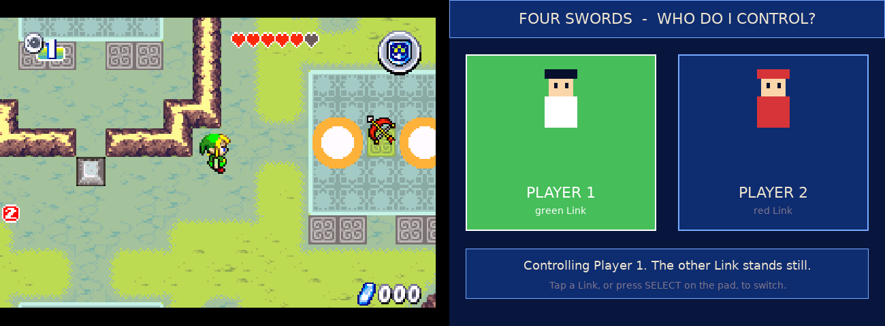
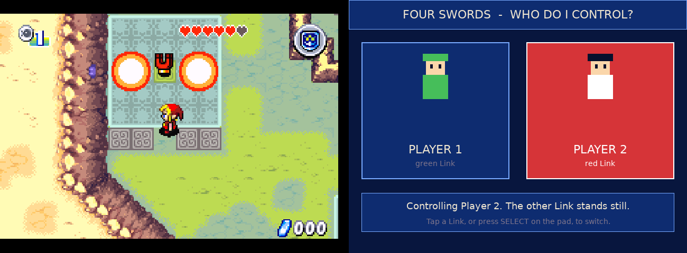

# Four Swords solo companion (RG DS)

Bottom-panel touch app for *The Legend of Zelda: Four Swords* (GBA, via RetroArch mGBA) played solo with the
`fourswords_solo.ips` patch. The patch fakes a second player on the link and adds a byte at EWRAM `0x0203FFF0`
(0 = your controls drive Player 1, 1 = Player 2; the other Link stands still). Select on the pad flips it.
This app shows that byte and sets it over RetroArch's network command port (UDP 55355): tap a Link to switch.

Top panel: the game, bottom panel: the companion. Player 1 (default), then Player 2 (the camera follows the selected Link):

- Apply `fourswords_solo.ips` to your own ROM (USA, `AZLE`); name the result `...Four Swords Solo....gba` so the launcher picks the companion.
- `./build.sh` (Docker, arm64) then `./deploy.sh`. The device's `gba-launch` wrapper needs a branch matching `*"Four Swords Solo"*` that starts `fs-bottom` and enables `network_cmd_enable` for the session.
- No ROMs or saves are included.

The camera follows the selected Link too (the patch repoints the game's camera target, IWRAM `0x03000450`, between the two Link entities).
`gba-launch` is the device wrapper with the Four Swords Solo branch added (the other games' branches are unchanged).
`fourswords_solo.ips` holds only the patch's own bytes (three small code ranges), no ROM data.
