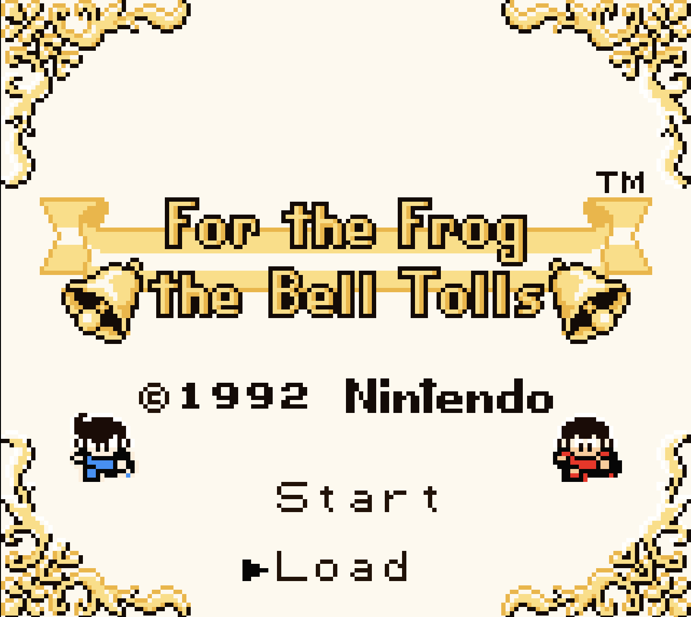
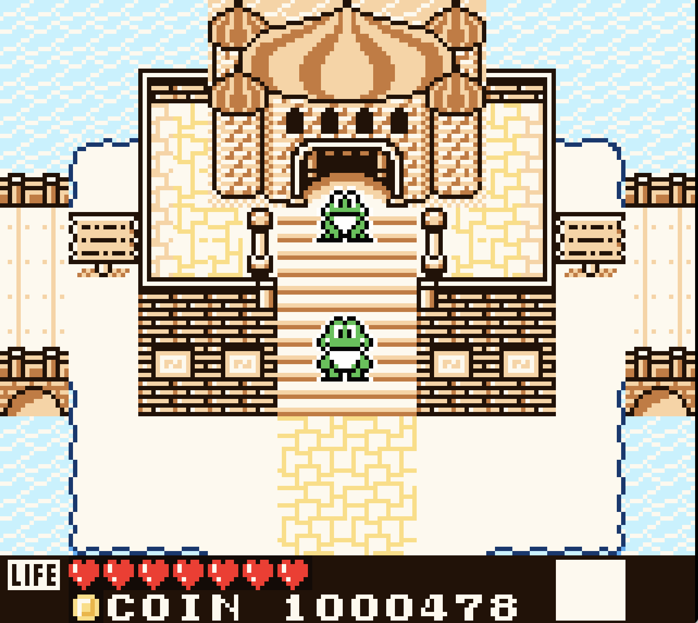
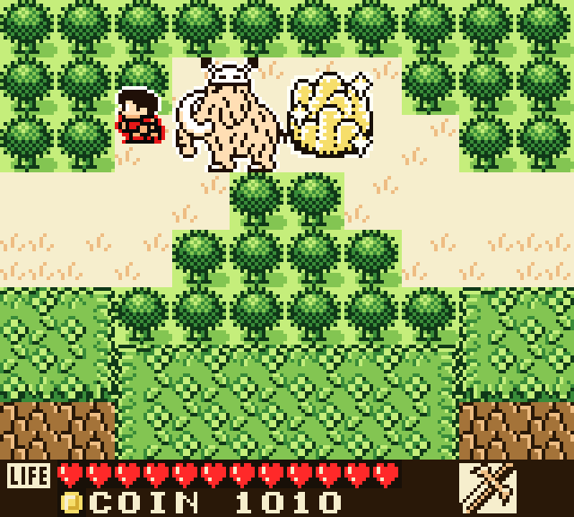

# For the Frog the Bell Tolls — Game Boy Color colourisation patch

`frog-color-v12.ips` (latest; older builds are in the `old/` folder) turns the monochrome DMG ROM into a Game Boy Color
(CGB-enhanced) game with full colour, while still booting on a plain DMG.

### Screens

|  |  |  |
|:--:|:--:|:--:|
| Castle steps | Overworld | Dialogue (new font) |

* Apply to **your own** copy of the original ROM
  (SHA-1 `90bddff5d48eedad6ec5157946f602ae4170e0c6`, 512 KB, English version).
* `python3 apply_patch.py apply original.gb frog-color-v12.ips frog-claude-color.gb`
  (or any IPS patcher, e.g. Flips).
* Run the result in a CGB-capable emulator (SameBoy, mGBA, BGB, Gambatte) or on a Game Boy Color.

## What the patch does
* Header flag $143 = $80 (CGB-compatible); header checksum fixed.
* Switches the CGB to double-speed mode at start-up (needed for the extra VRAM work),
  and compensates the sound timer reload so music tempo is unchanged.
* Keeps a palette class for every VRAM tile slot (looked up from a 32 KB table built
  into two previously empty ROM banks) and writes CGB BG attributes / OBJ palette bits
  whenever the game draws tiles, sprites or tilemaps.
* Uploads 8 BG + 8 OBJ palettes to CGB palette RAM, re-deriving them from the game's own
  BGP/OBP shadow registers so fades keep working.

## Changelog

### v12 (current, `frog-color-v12.ips`, 36,474 bytes)
Applies to the original ROM only (not on top of an older patch); the patched ROM has SHA-1
`70cecb6a7ee6bd77d0c62c78cf5aac22640ea2c0`. Everything in v11 plus:

* **Palettes**: pink OBJ palette 4 (princess dress), richer green BG palette 1, purple BG palette 4 for rooms.
* **Princess**: yellow hair, pink dress, neutral face in the overworld/cutscene frames; the portrait scene has a light-red
  heart backdrop with pink/yellow princess (both portrait layouts are recognised).
* **Snake boss**: red with peach outline and belly in all poses; **robot** enemy yellow; sword blade yellow.
* **Rooms**: the throne/temple room is purple (floor, border corners, roses and statues); arena ground is green; the ice
  cave is blue; the dungeon stones are purple.
* **Hero details**: black pupil in the crawl/climb pose, white outline in that pose, black outline on the front pose of the
  title screen; the boat hero's head is neutral skin, the boat stays green.
* **Fixes**: frogs green in every pose, blue-NPC/inn floor neutral, shop/diary details.

Notes: as before colour is per 8x8 tile, so shared tiles change in other areas too. Some frames of animated characters
(the blue character on the title screen, other princess poses) are still unfinished.

### v11 (previous, now `old/frog-color-v11.ips`, 36,413 bytes)
Applies to the original ROM only (not on top of an older patch); the patched ROM has SHA-1
`e12cb4bb0ff145d63fafca9b389ca7d197587e38`. Everything in v10 plus:

* **Title and menus all gold**: the logo ribbon, "For the Frog the Bell Tolls", the bells, "(c)1992" and "Nintendo" lettering
  are one gold-yellow class (this also removes the red/yellow colour leak across the ribbon), and the corner frame's
  vines are gold instead of green.
* **Diary screen**: the backdrop around the title and book is peach/tan instead of blue (water tiles are untouched).
* **Dungeons and castles**: brick/stone palette (BG class 4) is now purple with a lavender highlight.
* **Greens**: the grass/tree palette is a richer green; town trees, border hedges and grass tufts are green.
* **Shop seller**: his head uses the neutral palette like his body (no more red fringe from the hero's palette).
* **Eskimo (ice) village**: snow ground is icy blue, pines, houses and snowmen are purple.
* **Eye-patch frog NPC** (bank `$12` tiles `$124-$12b`) is frog green.

Notes: colour is per 8x8 tile, so tiles shared between areas change everywhere (the ice-village pines and snow tiles are
also used by other forests). Colours were tuned from a colour reference video; the shop interiors are still warm cream and
pink. v11 was built from a reconstructed assembly source of the ROM (not included here; it contains game code).

### v10 (previous, now `old/frog-color-v10.ips`, 36,648 bytes; byte-identical to `old/frog-color-v0.9.ips`, renamed; all further changes go into this file)
Applies to the original ROM only (not on top of an older patch). Colour fixes since v0.4:

* **Lava** is red: the lava body and surface frames (`$16:$304-$30a`) use the red BG palette; their black pixels are now the
  lava's dark red.
* **Fireballs** (flame sprite, both frames) are the same red as the lava (`#ff2929`); the red OBJ palette (heart pickup,
  apple, shield, hero body) now uses that red too.
* **Crystal ball**: the glass is light blue like the water (its stand stays neutral dark grey).
  BG palette 7 colour 0 is cream so the stand block has no grey box.
* **Treasure chests**: closed and open chest are both coin/chest yellow, and so is the chest monster (mimic) sprite.
* **Water / pool**: light-blue water palette also for the raised pool's basin tiles and the pool fill.
* **Princess and Mandola portraits** get scene palettes (pink dress, blonde hair, purple cloak and lavender backdrop).
* **Shop wares and pickups**: shield and apple red, knife with grey blade, egg white, heart pickup red; the pause-menu item
  icons stay neutral.
* **Hero poses** (crouch, falling, climbing) use the hero's skin / red-shirt palettes; frog crouch frame back to frog green.
* **Eye-patch frog NPC** is frog green; the yellow brick wall is red, the well is two-tone grey, the cross sign is a white
  cross on red.

Known limits: colour is per 8x8 tile, so a few outline pixels at tile edges take the neighbouring tile's colour (e.g. the
bottom two glass rows of the crystal ball are a flat light blue).

### v0.1 – v0.4, v0.9, v10, v11 (`old/`)
Earlier builds, kept for reference. The game's own pause-menu open/close animation is unchanged in all of them.

## Rebuilding / tuning colours
`source/` holds my assembler, the hook code (`hooks.s`) and the palette/tile
classification (`palconf.py`). Edit `palconf.py` and run `build.py` with your own ROM
path; nothing from the original game is stored in this folder.

## Legal
This patch contains only my own bytes (hook code, palette data, tile-class table).
It contains no original game code or audio. From v0.9 on it also carries a few re-drawn 8x8 tiles (font, well, cross sign, shop egg) as changed bytes; these are edits of the game's graphics, not whole assets. Do not distribute the
original ROM or the patched ROM. Laws vary; this is not legal advice.

