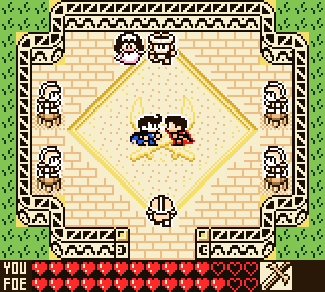

# For the Frog the Bell Tolls — Game Boy Color colourisation patch

`frog-color-v10.ips` (latest; older builds are in the `old/` folder) turns the monochrome DMG ROM into a Game Boy Color
(CGB-enhanced) game with full colour, while still booting on a plain DMG.

* Apply to **your own** copy of the original ROM
  (SHA-1 `90bddff5d48eedad6ec5157946f602ae4170e0c6`, 512 KB, English version).
* `python3 apply_patch.py apply original.gb frog-color-v10.ips frog-claude-color.gb`
  (or any IPS patcher, e.g. Flips).
* Run the result in a CGB-capable emulator (SameBoy, mGBA, BGB, Gambatte) or on a Game Boy Color.

## What the patch does
* Header flag $143 = $80 (CGB-compatible); header checksum fixed.
* Switches the CGB to double-speed mode at start-up (needed for the extra VRAM work),
  and compensates the sound timer reload so music tempo is unchanged.
* Keeps a palette class for every VRAM tile slot (looked up from a 32 KB table built
  into two previously empty ROM banks) and writes CGB BG attributes / OBJ palette bits
  whenever the game draws tiles, sprites or tilemaps.
* Uploads 8 BG + 8 OBJ palettes to CGB palette RAM, re-deriving them from the game's own
  BGP/OBP shadow registers so fades keep working.

## Changelog

### v10 (current, `frog-color-v10.ips`, 36,648 bytes; byte-identical to `old/frog-color-v0.9.ips`, renamed; all further changes go into this file)
Applies to the original ROM only (not on top of an older patch). Colour fixes since v0.4:

* **Lava** is red: the lava body and surface frames (`$16:$304-$30a`) use the red BG palette; their black pixels are now the
  lava's dark red.
* **Fireballs** (flame sprite, both frames) are the same red as the lava (`#ff2929`); the red OBJ palette (heart pickup,
  apple, shield, hero body) now uses that red too.
* **Crystal ball**: the glass is light blue like the water (its stand stays neutral dark grey).
  BG palette 7 colour 0 is cream so the stand block has no grey box.
* **Treasure chests**: closed and open chest are both coin/chest yellow, and so is the chest monster (mimic) sprite.
* **Water / pool**: light-blue water palette also for the raised pool's basin tiles and the pool fill.
* **Princess and Mandola portraits** get scene palettes (pink dress, blonde hair, purple cloak and lavender backdrop).
* **Shop wares and pickups**: shield and apple red, knife with grey blade, egg white, heart pickup red; the pause-menu item
  icons stay neutral.
* **Hero poses** (crouch, falling, climbing) use the hero's skin / red-shirt palettes; frog crouch frame back to frog green.
* **Eye-patch frog NPC** is frog green; the yellow brick wall is red, the well is two-tone grey, the cross sign is a white
  cross on red.

Known limits: colour is per 8x8 tile, so a few outline pixels at tile edges take the neighbouring tile's colour (e.g. the
bottom two glass rows of the crystal ball are a flat light blue).

### v0.1 – v0.4, v0.9 (`old/`)
Earlier builds, kept for reference. The game's own pause-menu open/close animation is unchanged in all of them.

## Rebuilding / tuning colours
`source/` holds my assembler, the hook code (`hooks.s`) and the palette/tile
classification (`palconf.py`). Edit `palconf.py` and run `build.py` with your own ROM
path; nothing from the original game is stored in this folder.

## Legal
This patch contains only my own bytes (hook code, palette data, tile-class table).
It contains no original game code or audio. From v0.9 on it also carries a few re-drawn 8x8 tiles (font, well, cross sign, shop egg) as changed bytes; these are edits of the game's graphics, not whole assets. Do not distribute the
original ROM or the patched ROM. Laws vary; this is not legal advice.

