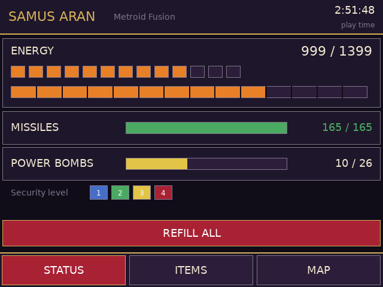
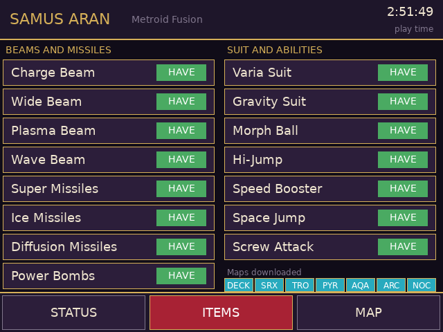
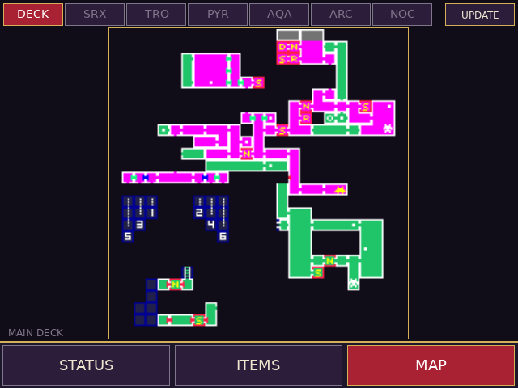

# Metroid Fusion companion (RG DS)

Touch companion for *Metroid Fusion (USA)* on the Anystream RG DS (ROCKNIX). The game runs in RetroArch's mGBA core on the top
panel; `mf-bottom` runs on the bottom panel (DSI-1) and shows three tabs:

<p>
 

</p>

| Tab | What it does |
| --- | --- |
| STATUS | Energy (with tanks), missiles and power bombs as bars; tap a bar to refill it, or REFILL ALL. Security level (the four lock colours) and play time |
| ITEMS | Beams, missile types, power bombs, suits and abilities with HAVE / NO switches (tap to give or take an upgrade, effective at once); the maps downloaded so far |
| MAP | The pause screen's map of each sector, full screen with a sector picker; `MAP !` / a yellow chip means you have explored since that copy was taken |

Nothing from the ROM is shipped: the maps are copied from your own running game and kept in `maps.cache` next to the app.

## How the map works
Fusion's pause map shows only the sector Samus is in, drawn as one 64x64-tile layer (BG3). The app copies that layer and files it
under the sector whose revealed-tile flags it matches (`0x02037C00`, 7 sectors x 32 rows x u32, bit c of row r = tile (c, r)). It does this
* once, automatically, the first time the game has been in normal play for a few seconds (the pause map flashes on the top screen
  while the app presses Start through RetroArch's network gamepad, and L if the pause screen opens on the status page),
* whenever you open the game's map yourself (the sector you are looking at is refreshed),
* when you tap UPDATE,
* automatically whenever the game has revealed new tiles in the sector you are in (a short flash of the pause map on the top screen, at most every 15 seconds); the AUTO UPDATE button on the tab turns this off.

The other sectors are filled in as you visit them and open the map there. The game does not rebuild its pause map from the
revealed-tile flags while it runs, so the picture cannot be redrawn live from them; the flags only tell which sector a picture
is and when it is out of date. There is no position marker yet.

## How it works
It talks to RetroArch's network command interface (UDP 55355, `READ_CORE_MEMORY` / `WRITE_CORE_MEMORY`), reads touch straight from the
bottom panel's evdev node, and the GBA wrapper (`gba-launch`) starts it with the game, opens the command port and the network gamepad
only for that session and closes them afterwards. Memory map: see `src/mf_data.h`. Highlights: Samus' equipment at IWRAM `0x03001310`
(energy, max energy, missiles, max missiles, power bombs, then bit masks for beams, missile types and suits, the security level and the
downloaded maps), play time at `0x03000138`, revealed map tiles at EWRAM `0x02037C00`.

## Build / install
```sh
./build.sh                         # arm64 Debian trixie container (needs Docker/colima) -> build/mf-bottom
DEVICE=192.168.0.105 ./deploy.sh   # copies mf-bottom, gba-launch and the device's DejaVuSans.ttf to /storage/roms/ports/mf-companion/
```
Then point the `gba` system's `<command>` in `/storage/.config/emulationstation/es_systems.cfg` (back it up first) at
`/storage/roms/ports/mf-companion/gba-launch %ROM% -P%SYSTEM% --core=%CORE% --emulator=%EMULATOR% --controllers="%CONTROLLERSCONFIG%"`
(or add the Fusion branch of `gba-launch` to the wrapper you already use). Other games still go through the stock launcher.
Create an empty `no-companion` file next to the wrapper to get plain mGBA.

## QA on the device
`qa/touchd.py` is a virtual multitouch screen (`qa/start_touchd.sh`, then `echo "tap:300,450" > /tmp/touch.fifo`) and `qa/start_app.sh`
runs the app against it. Set `MF_TEST_TAPS="ms,x,y;..."` to inject taps through the real tap handler. RetroArch pauses when the
companion window has the focus (the app then answers slowly); `swaymsg '[app_id="com.libretro.RetroArch"] focus'` puts it back.

## Caveats
* USA ROM only (`AMTE`). Writes go to the running game's RAM; nothing is saved until the game itself saves.
* The attract-mode demos on the title screen load their own equipment into the same memory, so the app shows those values until you load a file.
* Which bit is which upgrade was checked against the game's status screen for most bits; the rest follow the list order there.
* Difficulty, item percentage and boss progress are not shown yet.
