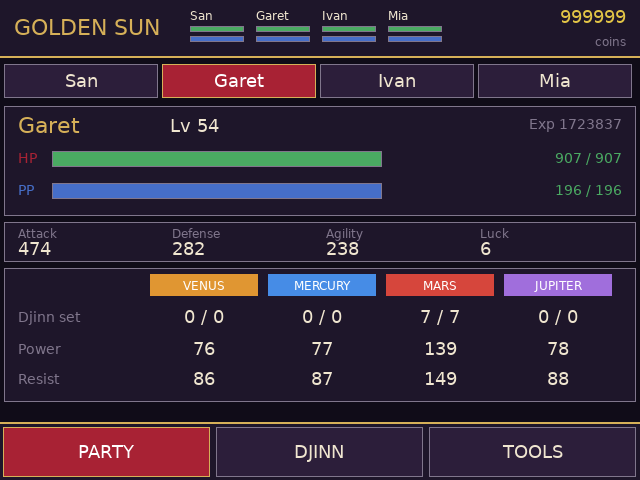
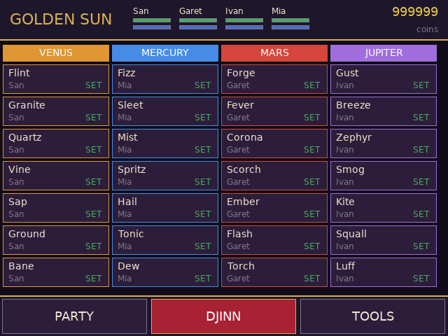
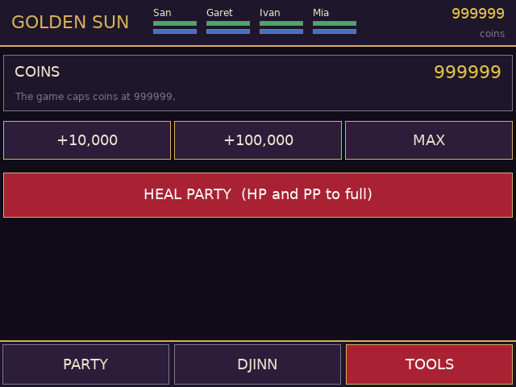

# Golden Sun companion (RG DS)

Touch companion for *Golden Sun (USA, Europe)* on the Anystream RG DS (ROCKNIX). The game runs in RetroArch's mGBA core on the top
panel; `gs-bottom` runs on the bottom panel (DSI-1) and shows three tabs:

<p>
 

</p>

| Tab | What it does |
| --- | --- |
| PARTY | Pick one of the four adventurers: level, HP / PP bars (tap a bar to refill it), experience, Attack / Defense / Agility / Luck, and per element the Djinn set, Power and Resist |
| DJINN | All 28 Djinn in the game's own order, who holds each one and whether it is set or on standby |
| TOOLS | Coins (+10,000 / +100,000 / MAX) and a one-tap heal for the whole party |

The header always shows the four HP / PP bars and the coins. Everything is read live from the running game.

## What is not here
Item, Psynergy and class names are not shown: the game keeps its text compressed in the ROM and only draws it as tiles, so the
companion has no way to read it. Everything shown (names of the adventurers, numbers, Djinn) comes from RAM; the Djinn names are
the game's fixed list (checked against the in-game Djinn menu).

## How it works
It talks to RetroArch's network command interface (UDP 55355, `READ_CORE_MEMORY` / `WRITE_CORE_MEMORY`), reads touch straight from the
bottom panel's evdev node, and the GBA wrapper (`gba-launch`) starts it with the game, opens the command port only for that session
and closes it afterwards. Memory map: see `src/gs_data.h`. Highlights: the party is four 0x14C-byte blocks from EWRAM `0x02000500`
(name, level, max HP / PP, HP / PP, stats, element power and resist, Djinn bit masks, experience); coins at `0x02000250`.

## Build / install
```sh
./build.sh                         # arm64 Debian trixie container (needs Docker/colima) -> build/gs-bottom
DEVICE=192.168.0.105 ./deploy.sh   # copies gs-bottom, gba-launch and the device's DejaVuSans.ttf to /storage/roms/ports/gs-companion/
```
Then point the `gba` system's `<command>` in `/storage/.config/emulationstation/es_systems.cfg` (back it up first) at
`/storage/roms/ports/gs-companion/gba-launch %ROM% -P%SYSTEM% --core=%CORE% --emulator=%EMULATOR% --controllers="%CONTROLLERSCONFIG%"`
(or add the Golden Sun branch of `gba-launch` to the wrapper you already use). Other games still go through the stock launcher.
Create an empty `no-companion` file next to the wrapper to get plain mGBA.

## QA on the device
`qa/touchd.py` is a virtual multitouch screen (`qa/start_touchd.sh`, then `echo "tap:300,450" > /tmp/touch.fifo`) and `qa/start_app.sh`
runs the app against it. Set `GS_TEST_TAPS="ms,x,y;..."` to inject taps through the real tap handler. RetroArch pauses when the
companion window has the focus; `swaymsg '[app_id="com.libretro.RetroArch"] focus'` puts it back.

## Caveats
* USA/Europe ROM only (`AGSE`); *The Lost Age* is a different game and is not matched. Writes go to the running game's RAM; nothing is saved until the game itself saves.
* A Djinn counts as "set" when its set bit is on; the game's recovery countdown after battle is not shown separately.
* The party order is the game's party order; characters that have not joined yet show as empty and the app waits for a loaded game.
