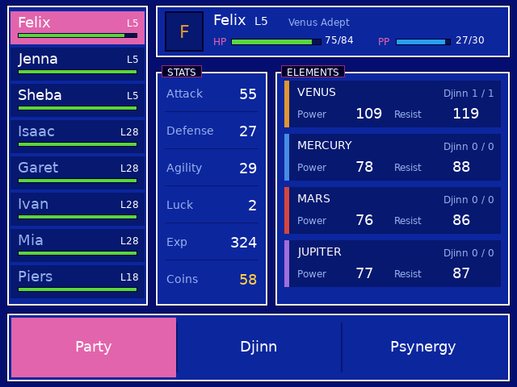
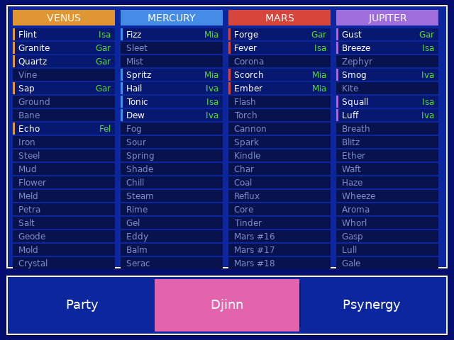
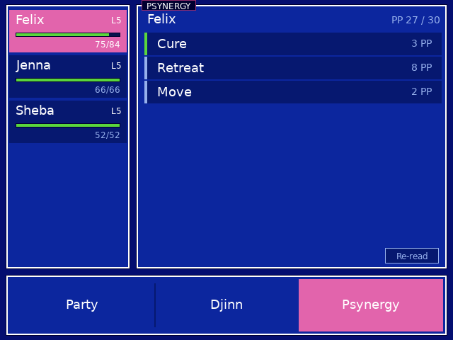

# Golden Sun: The Lost Age companion (RG DS)

Touch companion for *Golden Sun: The Lost Age (USA, Europe)* on the Anystream RG DS (ROCKNIX). The game runs in RetroArch's mGBA core
on the top panel; `gsl-bottom` runs on the bottom panel (DSI-1) and shows three tabs (Party, Djinn, Psynergy) in the game's blue menu look. It is the Golden Sun companion
(`golden-sun-companion/`) extended to the second game's eight characters and 72 Djinn.

<p>
 

</p>

| Tab | What it does |
| --- | --- |
| PARTY | Left: the active party first, then the others that have joined, with HP. Header: portrait, level, element, HP / PP bars (tap a bar to refill it). STATS: Attack / Defense / Agility / Luck / Exp / Coins (tap Coins for +10,000). ELEMENTS: Djinn set, Power and Resist per element |
| DJINN | All 72 Djinn (18 per element) in the game's order, who holds each one and whether it is set or on standby; grey = not found yet |
| PSYNERGY | The selected active-party member's pause-menu Psynergy; tap one to cast it (healing spells ask for the target) |

The header always shows the active party's HP / PP bars and the coins. Everything is read live from the running game.

## Psynergy
Read from the game's own Psynergy screen when you tap *Read Psynergy* (or *Re-read* after a level-up or party change): the companion presses
A > Psynergy through RetroArch's network gamepad (UDP 55400) and reads the list the screen builds in IWRAM (`0x03002944`, count at `0x03002994`,
screen depth pointer at `0x03000AF0`). Casting presses A > Psynergy > member > spell (Right turns the 5-per-page list) > target. Spell names
are not in RAM (compressed text), so `kPsy` in `src/main.c` maps known ids to names (the ids and most costs match the first game; Retreat costs
8 here); unknown ids show as `Psynergy XX` and still cast. Only the active party (up to four) can cast, and only with the field showing.
Item and class names are not readable either; character names are the fixed slot order.

## How it works
Same as the other companions: RetroArch's network command interface (UDP 55355, `READ_CORE_MEMORY` / `WRITE_CORE_MEMORY`), touch read from the
bottom panel's evdev node, and the GBA wrapper (`gba-launch`) starts it with the game and opens the command port only for that session.
Memory map: see `src/gsl_data.h`. The character blocks have the same layout as the first game, but eight of them (0x14C bytes each) start at
EWRAM `0x02000520` (slots: Isaac, Garet, Ivan, Mia, Felix, Jenna, Sheba, Piers); coins are at `0x02000250`; the active party is the byte list at
`0x0200001C` (slot numbers, `0xFF` ends it). Djinn are one bit each, 18 per element, in four u32 masks per character (held / set).

## Build / install
```sh
./build.sh                                   # arm64 Debian trixie container (needs Docker/colima) -> build/gsl-bottom
DEVICE=192.168.0.105 ./deploy.sh             # copies gsl-bottom, gba-launch and the device's DejaVuSans.ttf to /storage/roms/ports/gsl-companion/
WRAPPER=1 DEVICE=192.168.0.105 ./deploy.sh   # also installs gba-launch as the wrapper EmulationStation calls
```
EmulationStation's `gba` system calls `/storage/roms/ports/tmc-rgds/gba-launch`; `WRAPPER=1` replaces it with this folder's `gba-launch` (the same
wrapper with a Lost Age branch added; the previous one is kept as `gba-launch.bak-gsl`). Create an empty `no-companion` file in
`/storage/roms/ports/gsl-companion/` to get plain mGBA.

## QA on the device
`qa/touchd.py` is a virtual multitouch screen (`qa/start_touchd.sh`, then `echo "tap:300,450" > /tmp/touch.fifo`) and `qa/start_app.sh` runs the app
against it. Set `GSL_TEST_TAPS="ms,x,y;..."` to inject taps through the real tap handler. Taps on the HP / PP bars and TOOLS buttons change the running game.

## Caveats
* USA/Europe ROM only (`AGFE`); the first *Golden Sun* is a different game with its own companion. Writes go to the running game's RAM; nothing is saved until the game itself saves.
* Djinn names for Mars #16 to #18 are not confirmed yet and show as placeholders; the other 69 follow the game's known order (Echo checked in the running game).
* The active party is read from the list the game keeps next to the save header; it may lag behind a party change until the game refreshes it.
* A Djinn counts as "set" when its set bit is on; the game's recovery countdown after battle is not shown separately.
