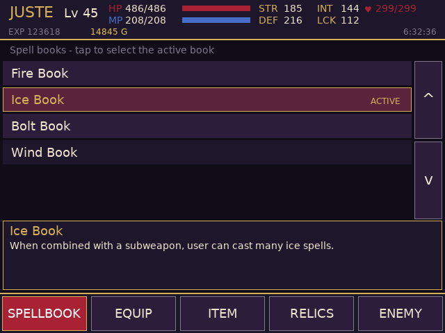
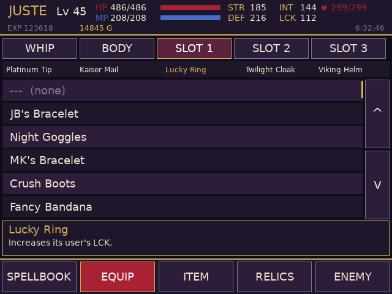
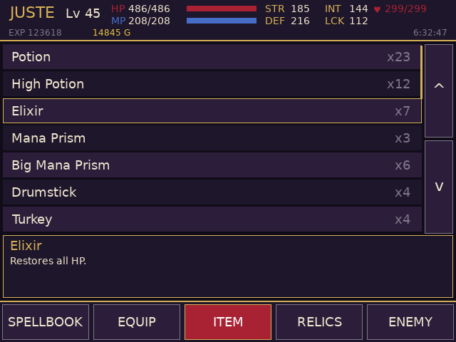
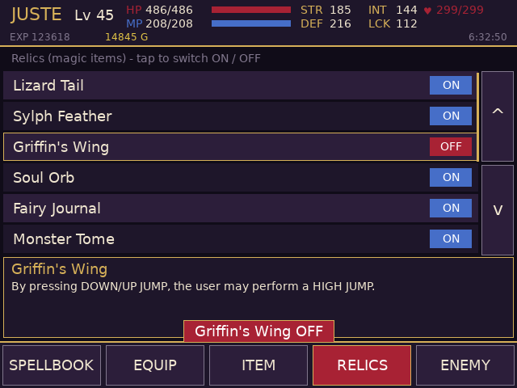
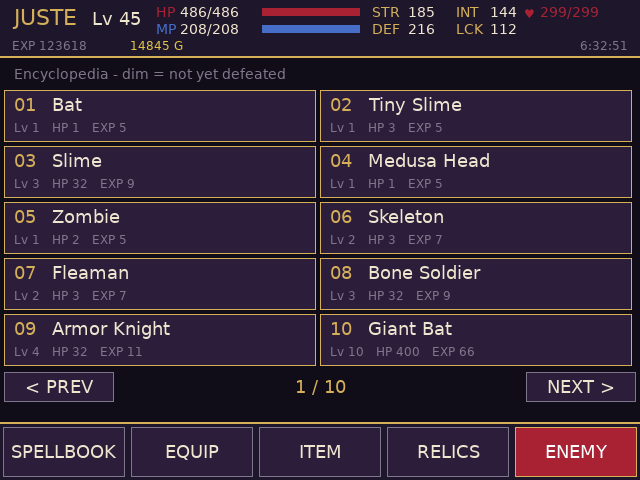
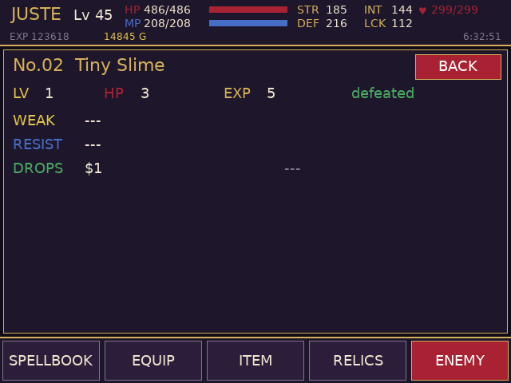

# Harmony of Dissonance companion (RG DS)

Touch companion for *Castlevania: Harmony of Dissonance (USA)* on the Anystream RG DS (ROCKNIX). The game runs in
RetroArch's mGBA core on the top panel; `hod-bottom` runs on the bottom panel (DSI-1) and shows five tabs:

<p>
 
 
 
</p>

| Tab | What it does |
| --- | --- |
| SPELLBOOK | Owned spell books (Fire / Ice / Bolt / Wind / Summoning Tome); tap to make one the active book |
| EQUIP | Whip attachment, body armor and the three accessory slots; owned gear with counts, tap to equip or clear. STR / DEF / INT / LCK and the stock counts are updated like the game does |
| ITEM | Consumables, keys, maps and jewels with counts and descriptions |
| RELICS | The twelve relics (magic items) with ON/OFF switches |
| ENEMY | The encyclopedia: all 100 enemies (level, HP, EXP, weakness, resistance, drops); dim = not yet defeated |

Lists scroll by dragging or with the arrow buttons. The header shows level, HP/MP, STR/DEF/INT/LCK, hearts, EXP, gold and play time.
Nothing from the ROM is shipped: names, descriptions and enemy data are read from the running game's ROM over RetroArch.

## How it works
It talks to RetroArch's network command interface (UDP 55355, `READ_CORE_MEMORY` / `WRITE_CORE_MEMORY`), reads touch straight
from the bottom panel's evdev node, and the GBA wrapper (`gba-launch`) starts it with the game, opens the command port only
for that session and closes it afterwards.

Memory map (EWRAM) and ROM tables: see `src/hod_data.h`. Highlights: player block at `0x02018770` (level, HP/MP, EXP, gold),
equipment bytes `0x02018780..84` (name index - 97 for body / three accessory slots, whip = name index - 88, `0xFF` = none),
consumable counts at `0x020187A0`, equipment counts at `0x020187BE` (a worn item is not in the stock count), spell book bits at
`0x0201877F`, relic switches at `0x02018841`. Text is 16-bit codes in the ROM string table at `0x08495498`; enemies are 36-byte
records at `0x080C7E44`.

## Build / install
```sh
./build.sh                         # arm64 Debian trixie container (needs Docker/colima) -> build/hod-bottom
DEVICE=192.168.0.105 ./deploy.sh   # copies hod-bottom, gba-launch and the device's DejaVuSans.ttf to /storage/roms/ports/hod-companion/
```
Then point the `gba` system's `<command>` in `/storage/.config/emulationstation/es_systems.cfg` (back it up first) at
`/storage/roms/ports/hod-companion/gba-launch %ROM% -P%SYSTEM% --core=%CORE% --emulator=%EMULATOR% --controllers="%CONTROLLERSCONFIG%"`.
Other games still go through the stock launcher. Create an empty `/storage/roms/ports/hod-companion/no-companion` file to get plain mGBA.

## QA on the device
`qa/launch_like_es.sh` launches the game through the wrapper with EmulationStation's environment; `qa/touchd.py` is a virtual
multitouch screen (`qa/start_touchd.sh`, then `echo "tap:300,450" > /tmp/touch.fifo`) and `qa/start_app.sh` runs the app against it.
Set `HOD_TEST_TAPS="ms,x,y;..."` to inject taps through the real tap handler.

## Caveats
* USA ROM only (`ACHE`). Writes go to the running game's RAM; nothing is saved until the game itself saves.
* Not verified: whip attachments are always listed (no ownership flags found); relic ownership and spell book ownership bits were
  inferred from this save; weakness/resistance bits other than Fire (1) and Thunder (4) are labelled by guess (Ice, Wind, Holy, ...).
* Relic switches and whip attachments do not recompute stats (the game does that itself); equipment changes do.
