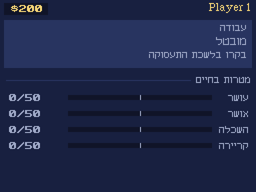
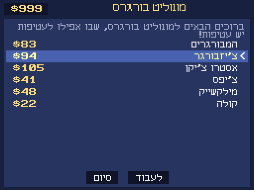
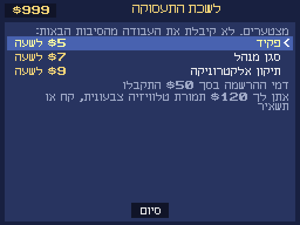
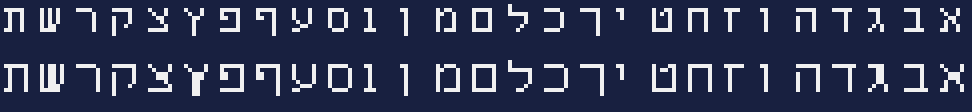

# Jones in the Fast Lane — Hebrew top screen (עברית)

A Hebrew version of the DS top screen for the [Jones in the Fast Lane NDS port](../jones-fast-lane). The game itself
(bottom screen) is unchanged and stays English; everything the port draws on the top screen is translated:

- **Player panel**: job, wage, life goals and their labels
- **Location panels**: place names, buttons, store items and prices, job lists and wages, university courses,
  stocks, the clerks' greetings and replies, newspaper headlines (about 590 phrases)

| Player panel | Store | Employment Office |
|---|---|---|
|  |  |  |

The panel is laid out right-to-left (mirrored), prices and numbers keep reading left-to-right inside Hebrew
sentences, and the letters come from a small pixel font made to sit with the game's two fonts:



## Building

Needs the same setup as the port (toolchain, your own copy of the game: see
[../jones-fast-lane/BUILDING.md](../jones-fast-lane/BUILDING.md)), plus Python 3.

```sh
make        # floppy release   -> ../jones-fast-lane/build/jones-he.nds
make cd     # CD release, voices -> ../jones-fast-lane/build/jones-cdrom-he.nds
```

(or from the port folder: `make he` / `make cd-he`). The ROMs run in the same emulators as the English ones; on the
Anbernic RG DS (BananaOS) use SuperDrastic.

## Files

| | |
|---|---|
| `hebrew.tsv` | the translations: `English<TAB>Hebrew`, UTF-8, one phrase per line |
| `mkhebrew.py` | the pixel font (as ASCII art) and the generator: turns the table and font into C at build time |
| `hebrew.c`, `hebrew.h` | lookup (with `%d`/`%s` patterns) and right-to-left ordering, used by the port's `topstatus.c` when built with `-DHEBREW` |
| `screens/` | the pictures above |

## Changing a translation

Edit `hebrew.tsv` and rebuild. Keys are matched after the clean-up the location panel does (`|` and newlines become
spaces, runs of spaces collapse, trailing dots go), so write them without padding. `%d` matches a number and `%s`
any text; the Hebrew side uses them in the same order, and a `%s` that is itself in the table (an item name, say) is
translated too:

```
I'll give you $%d for your %s, take it or leave it	אתן לך $%d תמורת %s, קח או תשאיר
```

Hebrew is stored as ISO-8859-8 (one byte per letter), so stick to the 27 letters, digits and ASCII punctuation
(`'` for geresh, `"` for gershayim). Text with no entry is shown in English. `make font` redraws the font preview.
