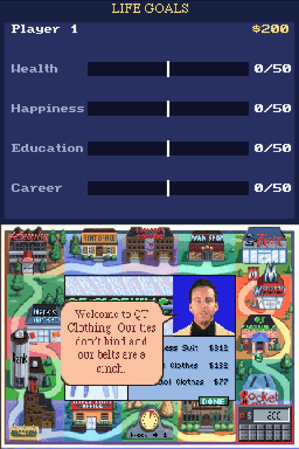
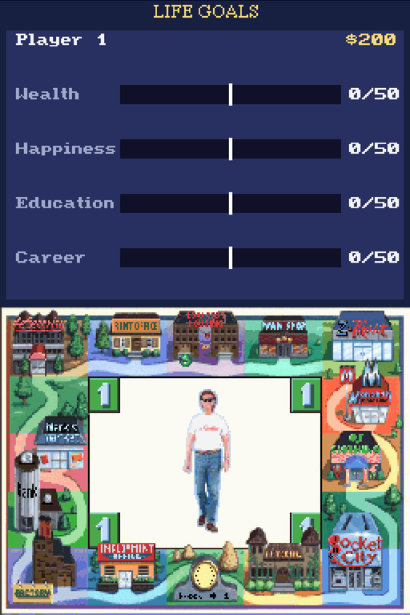
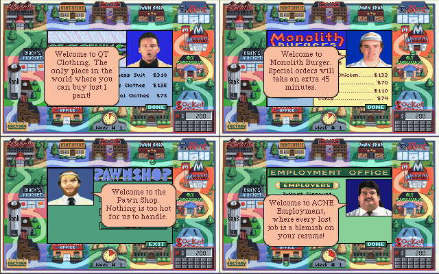
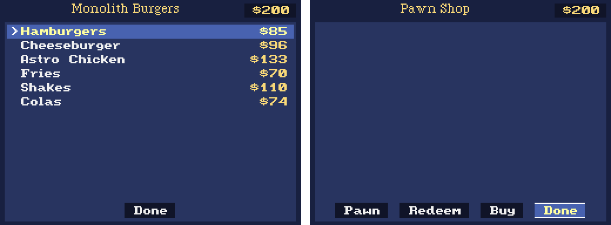

  

# Jones in the Fast Lane — Nintendo DS port

Sierra's 1991 life simulator running natively on the Nintendo DS (and the RG DS).
This is a new SCI1 engine written in C for libnds and calico. It runs the
game's own scripts, graphics and music, plus the CD release's character voices.

**No game files are included.** You build the ROM from your own copy of the
game; see **[BUILDING.md](BUILDING.md)**.

### Screens

|  |  |
|:--:|:--:|
| CD build: the clerk speaks, with a speech balloon | Walking the town; life goals on the top screen |

*QT Clothing, Monolith Burgers, the Pawn Shop and the Employment Office in the CD build (engine output at 320×200).*

*Top screen inside Monolith Burgers and the Pawn Shop.*

## Two ROMs

| ROM | From | Size | What you get |
|---|---|---|---|
| `jones.nds` | DOS floppy release | ~1.4 MB | The original game with AdLib music |
| `jones-cdrom.nds` | Windows 3.x CD release (+ floppy text) | ~25 MB | Character voices with lip sync, updated photos, speech balloons |

## Features

- **Bottom screen:** the 320×200 game, scaled by the DS hardware. Tap to click.
  The d-pad acts as the arrow keys; A/Start = Enter, B = Esc.
- **Top screen:** a *Life Goals* panel showing each player's cash and their
  wealth, happiness, education and career progress against their goals. It
  turns on once a game starts and stays dark before that.
- **Location panel:** inside a store, the bank, the university or another
  location, the top screen redraws it in the same style: the location's name,
  your cash top right, its items with prices and its buttons. The d-pad picks
  an entry and A selects it (taps still work on the bottom screen).
- **Music:** a software FM synth for the game's AdLib tracks, using the 48
  instrument patches from `patch.003`, mixed at 22 kHz.
- **Voices (CD):** raw 11 kHz speech clips, streamed from the ROM's file
  system (NitroFS) and mixed into the music. The mouth animation follows the
  clip's sync data.
- **Speech balloons (CD):** the CD release speaks its lines without showing
  them. The port draws the floppy's balloon over the frame, using the matching
  floppy text line (474 lines). The balloon uses the game's own corner and tail
  graphics.
- **Save / restore:** L = save, R = restore. Saves go to `/data/jones/` on the
  SD card.
- **RG DS:** runs in ROCKNIX's DSperate emulator with one DS screen per panel.
  See [BUILDING.md](BUILDING.md#anbernic-rg-ds-rocknix).

## How it works

| Part | File |
|---|---|
| Resource loader (Huffman / LZW, early and late SCI1 map formats, on-demand volume reads) | `src/engine/resource.c`, `decompress.c` |
| Script VM (flat 16-bit heap like DOS SCI), kernel calls | `src/engine/vm.c`, `kernel.c` |
| Pics, views, fonts, SCI1 palette merge | `src/engine/gfx.c`, `kgraphics.c` |
| Music synth, DoSound (early and late SCI1 numbering) | `src/engine/music.c`, `ksound.c` |
| CD speech, lip sync, subtitles, balloons | `src/engine/voice.c`, `subtitle.c`, `balloon.c` |
| Top-screen life goals and location panel | `src/engine/topstatus.c`, `locpanel.c` |
| DS platform: video, touch, audio thread, NitroFS, saves | `src/nds/main.c` |
| Subtitle table builder (floppy text → CD clip numbers) | `tools/textdump.c`, `tools/mksubs.py` |
| Headless test runner (renders frames, WAV, traces) | `tools/scirun.c` |

The CD release uses a newer interpreter than the floppy, and the engine detects
it at load time:

- 4-byte script exports
- absolute `lofs` operands
- 28-bit map offsets
- renumbered DoSound calls
- views with their own palettes

The CD release also runs a CPU speed test at startup. On a "slow" result it
skips the talking portraits, so the engine patches that test to pass.
