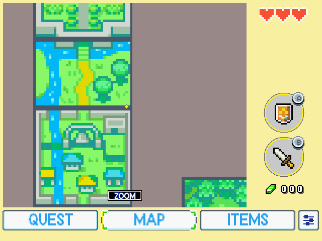
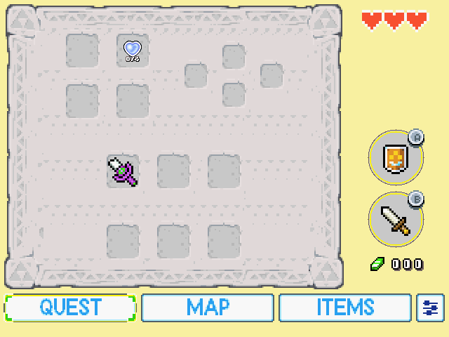
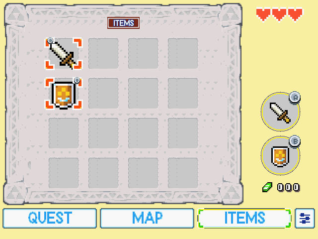

<p align="center">
  
</p>

# The Minish Cap — dual-screen for the RG DS (ROCKNIX)

The real game in mGBA on the top panel, and a touch **second screen** on the bottom panel: world map with Link's
position, quest status, items grid with tap-to-equip, and emulator save/load state. It is built on the
[`zelda-tmc-3ds`](https://github.com/EstebanPdN/zelda-tmc-3ds) second-screen code; the original ROM is used
**unmodified** (there is no ROM patch, so there is no `.ips` here).

|  |  |  |  |
|:--:|:--:|:--:|:--:|
| Map | Quest | Items (tap to equip) | Settings > Emulator |

## How it works
* **mGBA + companion (default).** RetroArch's mGBA core runs the ROM on the top panel (`DSI-2`). A small program,
  `tmc-bottom`, reads the game's RAM through RetroArch's network command interface, rebuilds the state the second
  screen needs, and draws it on the bottom panel (`DSI-1`). Equipping an item by touch is written back into the
  emulator, so the real HUD changes. Cost: under 1% of one core.
* **Native.** The same second screen next to this project's own engine (no emulator), 59.7 fps. Pick the core
  `minishcap-rgds`.
* The companion is **USA ROM only** (`BZME`); other regions fall back to plain mGBA.

Settings on the second screen show only what works here: panel backdrop, map options (windcrest pins, floor
auto-return) and **Emulator > Save State / Load State**, which use RetroArch state slot 9 so your own states are
never overwritten.

## What is in this folder
| Path | Contents |
| --- | --- |
| `source/platform/rgds/` | the RG DS port: SDL2 display/input/touch, native build, **companion** (`companion/`), launch wrapper, QA harness, Docker build |
| `source/platform/nds/` | an early Nintendo DS scaffold (boots, Slot-2 ROM mapping, software-PPU top screen, second screen on the sub screen) |
| `source/docs/NDS-PORT.md` | notes for the DS scaffold |
| `source/upstream-changes.patch` | the 7 upstream files that were changed, as a patch against `EstebanPdN/zelda-tmc-3ds` `main` |
| `SKILL-rgds-minishcap.md` | a Claude Code skill: device facts, architecture, pitfalls and the QA workflow |
| `screens/` | screenshots |

**Not included, on purpose:** the ROM, any extracted game data, the upstream engine/decompilation source, and
prebuilt binaries (they embed tables derived from the ROM). You build it yourself from the upstream project.

## Build
You need your **own** USA ROM (SHA-1 `b4bd50e4131b027c334547b4524e2dbbd4227130`) to play, and Docker to build.

```sh
git clone https://github.com/EstebanPdN/zelda-tmc-3ds && cd zelda-tmc-3ds
patch -p1 < /path/to/ports-rgds/minishcap/source/upstream-changes.patch
cp -R /path/to/ports-rgds/minishcap/source/platform/rgds platform/
cp -R /path/to/ports-rgds/minishcap/source/docs/. docs/
./platform/rgds/build.sh          # -> platform/rgds/build/tmc-bottom and tmc-rgds (aarch64)
```
The container is arm64 Debian trixie (glibc 2.41, the same as ROCKNIX) and links the device's own SDL2.

## Install on the RG DS
Everything lives in one folder, `/storage/roms/ports/tmc-rgds/`. It is **not** a Ports-menu entry:
EmulationStation only lists `.sh`/`.appimage` files there, and the wrapper has no extension on purpose.

1. Copy `tmc-bottom`, `tmc-rgds` and `source/platform/rgds/companion/gba-launch` into
   `/storage/roms/ports/tmc-rgds/` (`chmod +x`). Saves and settings are written in that same folder.
2. Put your ROM in `/storage/roms/gba/`.
3. Back up `/storage/.config/emulationstation/es_systems.cfg`, then in the `gba` system:
   * change the command to `/storage/roms/ports/tmc-rgds/gba-launch %ROM% -P%SYSTEM% --core=%CORE% --emulator=%EMULATOR% --controllers="%CONTROLLERSCONFIG%"`
   * add `<core>minishcap-rgds</core>` under the `retroarch` emulator's cores.
4. Restart EmulationStation and launch Minish Cap from the GBA list. The mGBA core opens the companion; the
   `minishcap-rgds` core opens the native build.

The wrapper opens RetroArch's network port only while Minish Cap runs, closes it afterwards, and powers the lower
panel off again. Create an empty `no-companion` file next to it to get plain mGBA.

## Status
Tested on a real RG DS: launch exactly as EmulationStation does it, map/quest/items/settings by touch (software
taps and a virtual multitouch screen), equip write-back, save/load state, a 4-minute soak (51 MB, no errors), clean
exit. Not tested: a real finger on the glass, dungeon maps, other regions, long sessions. Native build: no audio yet.

## Credits and legal
Based on [EstebanPdN/zelda-tmc-3ds](https://github.com/EstebanPdN/zelda-tmc-3ds),
[zeldaret/tmc](https://github.com/zeldaret/tmc) (the RAM map in `companion/tools/tmc_linker.ld` is its `linker.ld`),
[Project Picori](https://github.com/999sian/tmc), [samyost1/tmc-android](https://github.com/samyost1/tmc-android),
RetroArch and mGBA. The glue code here is GPL-3.0-or-later like the project it extends.

*The Legend of Zelda: The Minish Cap* belongs to Nintendo. This is an unofficial fan project, not affiliated with
or endorsed by Nintendo. No ROM or game data is distributed here; use a copy you legally own.
