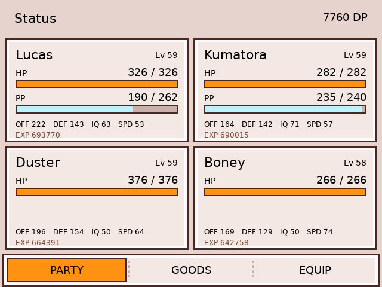
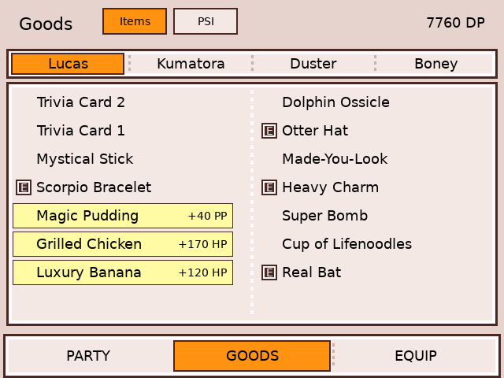
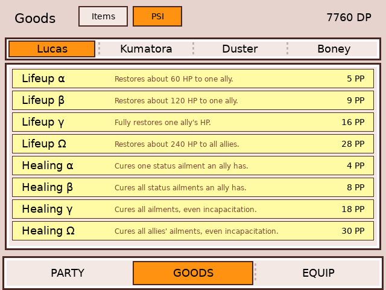
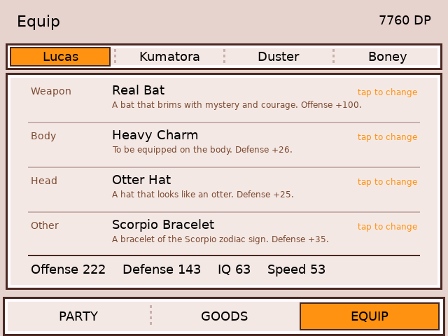
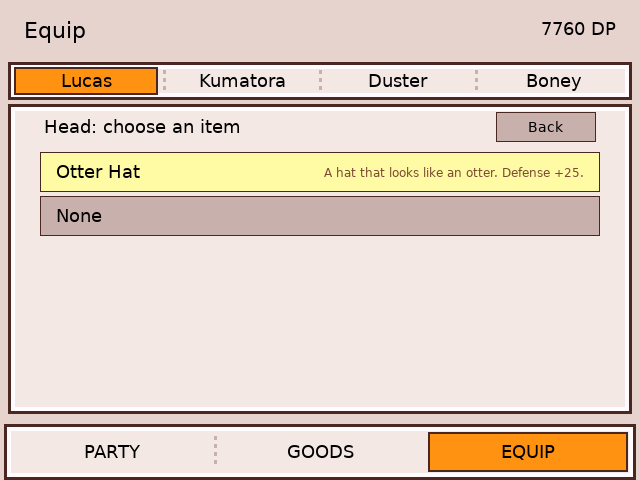

# Mother 3 companion (RG DS)

  
 

Touch companion for **Mother 3 (fan translation v1.3)** on the ROCKNIX RG DS. RetroArch's mGBA core runs the game on the
top screen; `m3-bottom` (SDL2, 640x480) runs on the bottom panel.

## Tabs

- **PARTY** – the four party members: name, level, live HP / PP bars, offense, defense, IQ, speed, EXP; DP in the header.
- **GOODS** – each member's 16-slot Goods list (the game's own two-column order, `(E)` marks worn items). Healing items
  (HP / PP restores, read from the ROM's item descriptions) are highlighted with their amount. **Tap one to use it on the
  member whose list you are viewing.** The companion presses Start > Goods > that member's tab > the item > Use > the
  member through RetroArch's network gamepad (UDP 55400), waits on the menu state at `0x02005C00`, then backs out to the
  field. The top screen shows the menu for a few seconds.
  A second **PSI** view (header pill) lists the Lifeup / Healing PSI each character has learned (the only ones the pause menu
  can cast on the field). The list is read from the game's PSI screen once at first use (and again after a level-up); tapping a
  spell drives Start > PSI > character > spell > target. Single-target spells ask for the ally on the companion.

- **EQUIP** – each member's weapon, body, head and other slot with the item's description and the Offense / Defense / IQ /
  Speed totals. **Tap a slot to pick another item** from that member's Goods (or None). The companion writes the new id into
  the member's equipment bytes, then opens and leaves the game's own Equip screen, which recalculates the stats. Slot and
  fit come from the ROM's item table (`0x080E5120`, `0x6C` bytes per item); weapons are limited to the weapon family the
  member already uses (sticks and bats, gloves, shoes, dog weapons) and collars to Boney, so it can offer an item the game's
  own picker would hide for a few special cases.

## Memory map (A3UJ)

| What | Address |
| --- | --- |
| Save records, stride `0x6C`, by character id (0 Lucas, 1 Duster, 2 Kumatora, 3 Boney ...): HP, PP, max HP | `0x02004200` |
| ... equipment (weapon, body, head, other), u8 item ids | record + `0x1C` |
| ... Goods, 16 x u8 item ids (left, right, left, right ...) | record + `0x24` |
| ... name (u16, `A` = 0x21, `a` = 0x41), level (u8), EXP (u32) | record - `0x16`, - 6, - 4 |
| Live HP / PP of party slot n (u16) | `0x0200DE10` / `0x0200DE4C` + `0x0C` * n |
| Max HP / PP, offense, defense, IQ, speed of slot n | `0x0200D818` + `0x30` * n (+8, +0x10, +0x16, +0x1C, +0x22, +0x28) |
| DP (money), u32 | `0x02004868` |
| Menu state: 0 field, 14 main menu, 10 Goods | `0x02005C00` |

Item names are the ROM's table at `0x09F8C404` (0x2C bytes per item, 16-bit characters) and the healing amounts come from
the descriptions at `0x08CFE368 + 2 entries`; `src/m3_items.h` is generated from them.

## Build and install

`./build.sh` (Docker, arm64) then `./deploy.sh`; `WRAPPER=1 ./deploy.sh` also installs this folder's `gba-launch` (the
master wrapper with every companion's branch, old one kept as `gba-launch.bak-m3`). RetroArch's network command and gamepad
ports are enabled only while the game runs.
