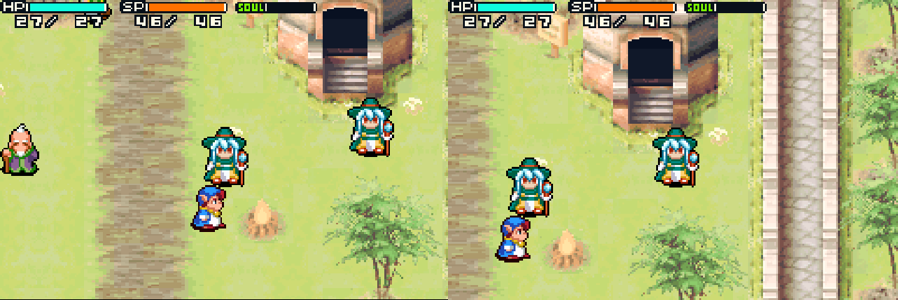

# Shining Soul II over wifi (two handhelds)

Plays the **Multiplayer Mode** of *Shining Soul II* (GBA, USA, `AU2E`) between two ROCKNIX handhelds on the same wifi,
the way two Game Boy Advances would play over a link cable (co-op, item trading, Royal Coliseum). Each handheld runs its
own copy of the game in RetroArch's mGBA core; a small bridge passes the link records between them.

## How it works
* `shiningsoul2_netplay.ips` (338 bytes, my own bytes only, no ROM data) replaces the link library's poll
  (`0x8001804`) with a routine that hands the game's 24-byte link record to the bridge and gives the game the other
  player's record in the slot a real cable would fill (this console's own record also comes back in its own slot, as
  the SIO hardware does). It also points the library's "which player am I" reads (SIOCNT bits 4-5) at a byte the bridge
  sets, so one console is player 1 and the other player 2. Everything above that (lobby handshake, character data
  exchange, gameplay sync) is the game's own code, unchanged.
* `ss2-link.py` runs next to RetroArch on each handheld. It reads this console's outgoing record and writes the other
  console's records into the game through RetroArch's local UDP command port (`network_cmd_enable`). It only touches
  game memory when it sees the patched ROM's marker. About 60 records per second each way.
* `gba-launch` starts the bridge for the length of a "Shining Soul II Netplay" session and stops it afterwards.

## Setup (both handhelds)
1. Apply the patch to your own ROM: `python3 apply_ips.py "Shining Soul II (USA).zip" shiningsoul2_netplay.ips "Shining Soul II Netplay (USA).gba"` and put the result in `/storage/roms/gba/` (copy the `.srm` save too if you want your characters).
2. Copy `ss2-link.py` and `gba-launch` to `/storage/roms/ports/ss2-link/` and write the other handheld's IP into `/storage/roms/ports/ss2-link/peer`.
3. Point the GBA launch command in `es_systems.cfg` at `/storage/roms/ports/ss2-link/gba-launch` (or merge its `Shining Soul II Netplay` branch into an existing wrapper).
4. Start the game on both. The handheld with the lower IP address is player 1.

## Playing
On both: title screen, **MULTIPLAYER MODE**, pick a file, character, colour and name. Both then show "Waiting for
player...", and the game goes on from there. Each player controls their own character.

`/tmp/ss2-link.log` shows the connection status, round-trip time and packet counts.

## Rebuilding
`python3 build_net.py "Shining Soul II (USA).zip" "Shining Soul II Netplay (USA).gba" shiningsoul2_netplay.ips` builds the patch and the patched ROM (needs clang with the `thumbv4t` target).
