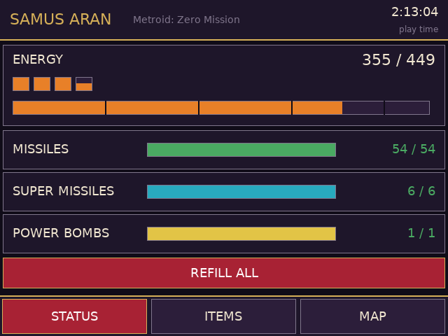
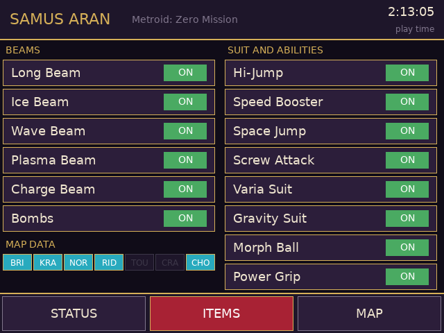
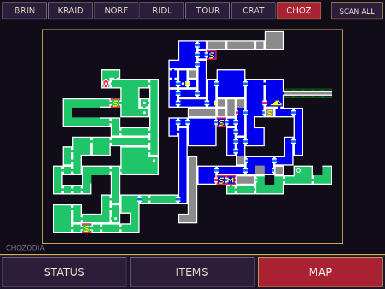
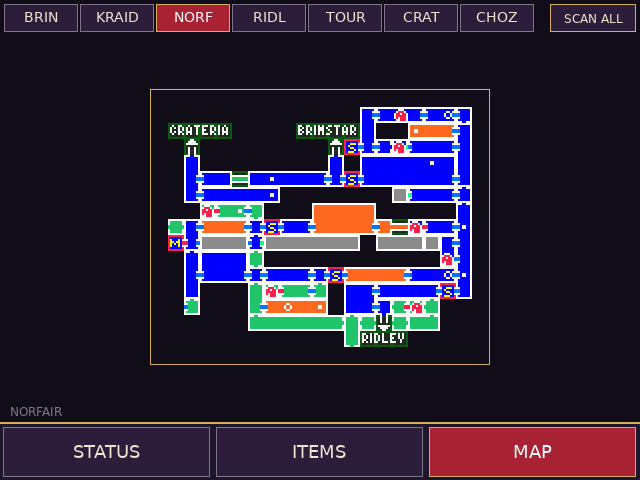

# Metroid: Zero Mission companion (RG DS)

Touch companion for *Metroid: Zero Mission (USA)* on the Anystream RG DS (ROCKNIX). The game runs in RetroArch's mGBA core
on the top panel; `zm-bottom` runs on the bottom panel (DSI-1) and shows three tabs:

<p>
 
 
</p>

| Tab | What it does |
| --- | --- |
| STATUS | Energy (with tanks), missiles, super missiles and power bombs as bars; tap a bar to refill it, or REFILL ALL. Play time in the header |
| ITEMS | The six beams / bombs and the eight suit parts and abilities you own, with ON/OFF switches (tap to switch, like the in-game status screen); the maps downloaded so far |
| MAP | The pause screen's map of every area, full screen with an area picker; `MAP !` / a yellow area chip means you have explored since that copy was taken |

Nothing from the ROM is shipped: the maps are copied from your own running game and kept in `maps.cache` next to the app.

## How the map works
The pause screen (Start) draws the area as one 64x64-tile layer (BG3). The app copies that layer and files it under the area whose
visited-tile flags it matches (`0x02037400`, 7 areas x 32 rows x u32, bit c of row r = tile (c, r)). It does this
* once, automatically, the first time the game has been in normal play for a few seconds (about 25 seconds; the pause map flashes on
  the top screen while the app presses Start and SELECT through RetroArch's network gamepad and copies each area),
* whenever you open the game's map yourself (the area you are looking at is refreshed),
* when you tap SCAN ALL.

The game does not rebuild its pause map from the visited-tile flags while it runs, so the picture cannot be redrawn live from
them; the flags are only used to tell which area a picture is and when it is out of date. There is no position marker yet.

## How it works
It talks to RetroArch's network command interface (UDP 55355, `READ_CORE_MEMORY` / `WRITE_CORE_MEMORY`), reads touch straight from the
bottom panel's evdev node, and the GBA wrapper (`gba-launch`) starts it with the game, opens the command port and the network gamepad
only for that session and closes them afterwards. Memory map: see `src/zm_data.h`. Highlights: Samus' equipment at IWRAM `0x03001530`
(max energy / missiles / super / power bombs, then the current values, then beams and suits owned and switched on, then the downloaded
maps), play time at `0x03000150`, visited map tiles at EWRAM `0x02037400`.

## Build / install
```sh
./build.sh                         # arm64 Debian trixie container (needs Docker/colima) -> build/zm-bottom
DEVICE=192.168.0.105 ./deploy.sh   # copies zm-bottom, gba-launch and the device's DejaVuSans.ttf to /storage/roms/ports/zm-companion/
```
Then point the `gba` system's `<command>` in `/storage/.config/emulationstation/es_systems.cfg` (back it up first) at
`/storage/roms/ports/zm-companion/gba-launch %ROM% -P%SYSTEM% --core=%CORE% --emulator=%EMULATOR% --controllers="%CONTROLLERSCONFIG%"`
(or add the Zero Mission branch of `gba-launch` to the wrapper you already use). Other games still go through the stock launcher.
Create an empty `no-companion` file next to the wrapper to get plain mGBA.

## QA on the device
`qa/touchd.py` is a virtual multitouch screen (`qa/start_touchd.sh`, then `echo "tap:300,450" > /tmp/touch.fifo`) and `qa/start_app.sh`
runs the app against it. Set `ZM_TEST_TAPS="ms,x,y;..."` to inject taps through the real tap handler. RetroArch pauses when the
companion window has the focus; `swaymsg '[app_id="com.libretro.RetroArch"] focus'` puts it back.

## Caveats
* USA ROM only (`BMXE`). Writes go to the running game's RAM; nothing is saved until the game itself saves.
* The beam / suit bit order is the one from the Zero Mission decompilation; the ON/OFF writes were checked in the game for the beams byte.
* Difficulty, item percentage and boss progress are not shown yet.
